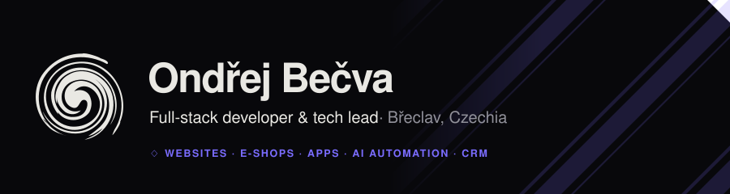
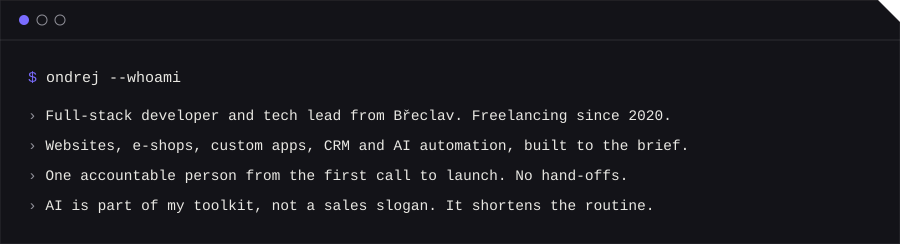
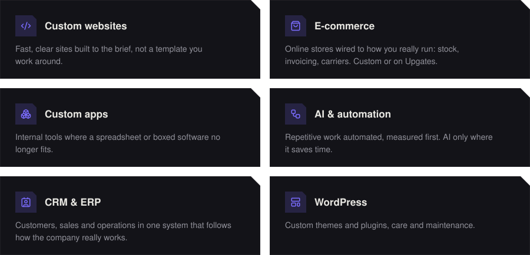
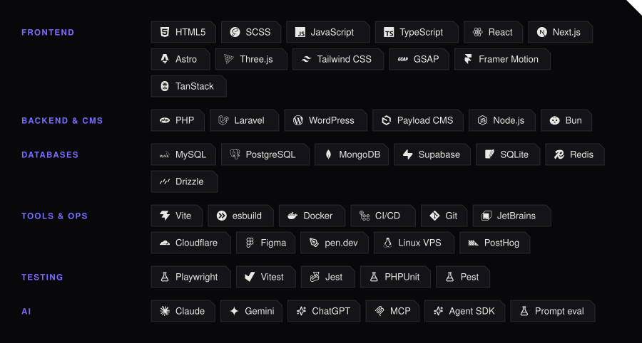
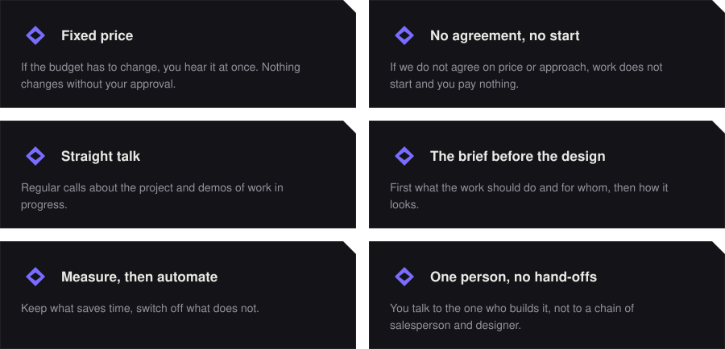

<b>English</b> · <a href="README.cs.md">Čeština</a>

<picture>
  <source media="(prefers-color-scheme: dark)" srcset="assets/hero-en-dark.svg">
  <source media="(prefers-color-scheme: light)" srcset="assets/hero-en-light.svg">
  
</picture>

 

<picture>
  <source media="(prefers-color-scheme: dark)" srcset="assets/whoami-en-dark.svg">
  <source media="(prefers-color-scheme: light)" srcset="assets/whoami-en-light.svg">
  
</picture>

 

## ◇ &nbsp;What I build

<picture>
  <source media="(prefers-color-scheme: dark)" srcset="assets/services-en-dark.svg">
  <source media="(prefers-color-scheme: light)" srcset="assets/services-en-light.svg">
  
</picture>

 

## ◇ &nbsp;Toolbox

<picture>
  <source media="(prefers-color-scheme: dark)" srcset="assets/stack-en-dark.svg">
  <source media="(prefers-color-scheme: light)" srcset="assets/stack-en-light.svg">
  
</picture>

 

## ◇ &nbsp;How I work

<picture>
  <source media="(prefers-color-scheme: dark)" srcset="assets/principles-en-dark.svg">
  <source media="(prefers-color-scheme: light)" srcset="assets/principles-en-light.svg">
  
</picture>

 

<b>◇ &nbsp;Experience</b>

 

| | |
| :-- | :-- |
| 2020 – | **Freelance software engineer &amp; tech lead** — projects from small sites to corporate solutions, leading teams |
| 2020 – 2024 | **Full-stack developer · Softmedia** |
| 2018 – 2020 | **Web developer, front-end &amp; back-end · Adler &amp; Co** |
| 2018 – 2019 | **Front-end developer · IDEATECH** |

Specialised in WordPress, Laravel and JavaScript frameworks (Vue.js, React), with AI in everyday work.

 

## ◇ &nbsp;Find me

<a href="https://www.ondrejbecva.cz"><picture>
  <source media="(prefers-color-scheme: dark)" srcset="assets/chip-site-en-dark.svg">
  <source media="(prefers-color-scheme: light)" srcset="assets/chip-site-en-light.svg">
  
</picture></a>
&nbsp;
<a href="https://www.linkedin.com/in/ondrejbecva/"><picture>
  <source media="(prefers-color-scheme: dark)" srcset="assets/chip-linkedin-en-dark.svg">
  <source media="(prefers-color-scheme: light)" srcset="assets/chip-linkedin-en-light.svg">
  
</picture></a>
&nbsp;
<a href="mailto:mail@ondrejbecva.cz"><picture>
  <source media="(prefers-color-scheme: dark)" srcset="assets/chip-email-en-dark.svg">
  <source media="(prefers-color-scheme: light)" srcset="assets/chip-email-en-light.svg">
  
</picture></a>

<!-- The images are generated: edit scripts/content.mjs and run `npm run build`. -->
